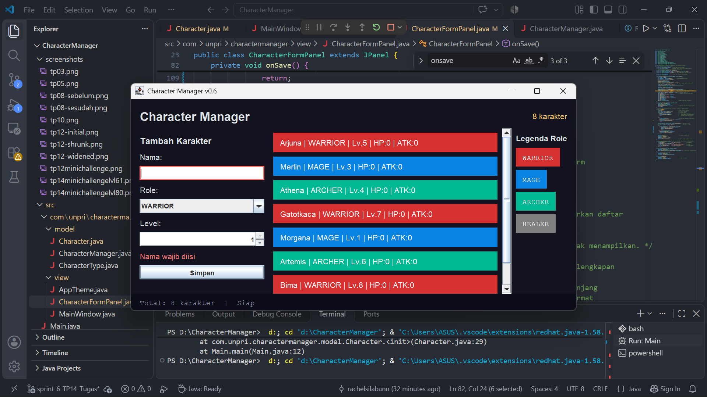
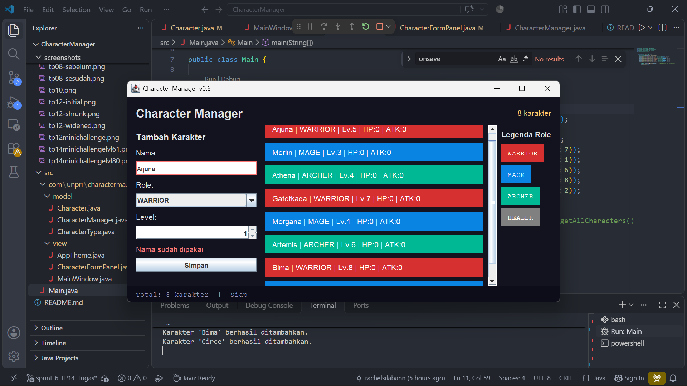
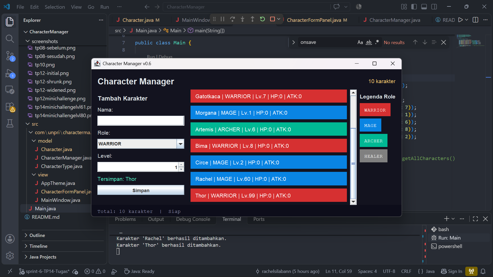

## TP14 — Input & Validation

### A. Implementasi Form Input dan Validasi

Pada TP14, aplikasi Character Manager dikembangkan dengan menambahkan form input karakter menggunakan komponen Swing, yaitu `JTextField` untuk nama, `JComboBox` untuk role, dan `JSpinner` untuk level.

Validasi nama dilakukan secara berurutan, mulai dari kelengkapan nama, panjang karakter, format nama, hingga pemeriksaan nama duplikat. Validasi aturan karakter juga diterapkan pada Model menggunakan `IllegalArgumentException`, termasuk aturan khusus MAGE yang memiliki level maksimal 60.

Pesan kesalahan ditampilkan langsung pada form dengan perubahan border menjadi merah. Jika input berhasil, form akan dikosongkan dan karakter baru langsung ditampilkan pada daftar karakter.

### B. Screenshot Pengujian

**1. Error Nama Kosong**

**2. Error Nama Duplikat**

**3. Berhasil Menambahkan Karakter**

### C. Tabel Pengujian

| No. | Kasus Pengujian | Hasil yang Diharapkan | Hasil Aktual | Status |
|---|---|---|---|---|
| 1 | Nama kosong | Nama wajib diisi | Pesan error muncul | Berhasil |
| 2 | Nama duplikat (Arjuna) | Nama sudah dipakai | Pesan error muncul | Berhasil |
| 3 | Nama kurang dari 3 karakter (Al) | Nama harus 3-20 karakter | Pesan error muncul | Berhasil |
| 4 | Nama mengandung angka (Rachel123) | Nama hanya huruf dan spasi | Pesan error muncul | Berhasil |
| 5 | Nama lebih dari 20 karakter | Nama harus 3-20 karakter | Pesan error muncul | Berhasil |
| 6 | MAGE level 61 | Ditolak karena melebihi batas level | Pesan error muncul | Berhasil |
| 7 | MAGE level 60 | Karakter berhasil disimpan | Karakter berhasil ditambahkan | Berhasil |
| 8 | WARRIOR level 99 | Karakter berhasil disimpan | Karakter berhasil ditambahkan | Berhasil |

**Catatan Pengujian:**

Seluruh delapan kasus pengujian menghasilkan hasil sesuai dengan yang diharapkan. Tidak ditemukan perbedaan antara hasil aktual dan hasil yang diharapkan sehingga tidak diperlukan tindakan perbaikan tambahan berdasarkan pengujian tersebut.

### D. Aturan Validasi Tambahan

Dua aturan validasi tambahan yang digunakan:

1. **Nama hanya boleh mengandung huruf dan spasi (View).** Aturan ini diterapkan melalui method `validateName()` untuk mencegah nama yang mengandung angka atau simbol.
2. **Mana tidak boleh bernilai negatif (Model).** Aturan ini diterapkan pada method `setMana()` menggunakan `IllegalArgumentException` agar nilai mana tetap valid.

### E. Kompromi Sementara

Pada tahap pengembangan ini, `ActionListener` masih digunakan secara langsung untuk menangani aksi tombol Simpan dan input Enter pada kolom nama. Selain itu, View masih memanggil `manager.addCharacter()` secara langsung untuk menambahkan karakter yang telah lolos validasi. Kedua hal tersebut merupakan kompromi sementara agar proses input dapat berjalan dengan sederhana. Pada pengembangan selanjutnya, pemisahan tanggung jawab dapat diperbaiki melalui penerapan Controller sesuai konsep MVC.

### F. Analisis TP14 — Bagian D

Dokumen analisis: [TP14 — Input & Validation](https://1drv.ms/w/c/8cf06abcf94f4402/IQBQv2ZtPsJNS7n0I8FbtAU3AZE-RGyGXWCjhg0ceRSg1Zw?e=TQNTck)

### Identitas Mahasiswa
- Nama: Rachel Clarita Oktaviana Br Silaban
- NIM: 253303621203
- Kelas: Sistem Informasi 3 Pagi A
- Tugas: TP14 — Input & Validation