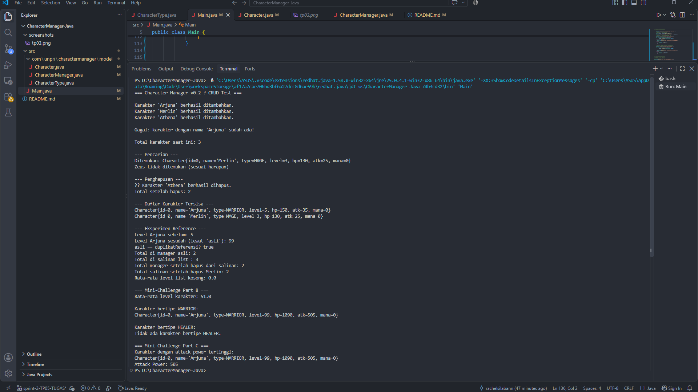

# Character Manager — TP05 TUGAS

## Deskripsi Project

Character Manager adalah program berbasis Java yang digunakan untuk mengelola data karakter. Program ini menerapkan konsep pemrograman berorientasi objek (Object-Oriented Programming) dan menyediakan fitur untuk menambahkan, mencari, menghapus, serta menganalisis karakter.

## Fitur Program

### Bagian A — CRUD dan Encapsulation
- `addCharacter()` digunakan untuk menambahkan karakter baru dan menolak nama karakter yang duplikat.
- `findByName()` digunakan untuk mencari karakter berdasarkan nama.
- `removeCharacter()` digunakan untuk menghapus karakter berdasarkan nama.
- `getTotalCharacters()` digunakan untuk menghitung jumlah karakter.
- `getAllCharacters()` mengembalikan salinan ArrayList agar perubahan pada daftar salinan tidak mengubah struktur daftar asli.
- `equals()` membandingkan karakter berdasarkan nama.

### Bagian B — Mini-Challenge
- `getAverageLevel()` menghitung rata-rata level seluruh karakter dan mengembalikan `0.0` jika daftar kosong.
- `findByType(CharacterType type)` mencari semua karakter berdasarkan tipe, seperti WARRIOR, MAGE, ARCHER, atau HEALER.

### Bagian C — Fitur Analitik
#### Method `findStrongest()`
Method `findStrongest()` digunakan untuk menemukan karakter dengan nilai `attackPower` tertinggi.
**Rasional Pemilihan Fitur**
Fitur ini dipilih karena membantu pengguna mengetahui karakter dengan daya serang tertinggi secara otomatis tanpa harus membandingkan data karakter satu per satu. Fitur ini juga dapat dikembangkan untuk membantu analisis kekuatan karakter dalam permainan.
**Cara Kerja**
Method memeriksa daftar karakter. Karakter pertama digunakan sebagai nilai awal, kemudian setiap karakter dibandingkan berdasarkan `attackPower`. Jika ditemukan karakter dengan daya serang lebih tinggi, karakter tersebut menjadi kandidat terkuat.
Jika daftar karakter kosong, method mengembalikan `null`.
**Encapsulation**
Method tidak mengembalikan ArrayList internal milik CharacterManager. Method hanya mengembalikan satu objek Character yang memiliki nilai attack power tertinggi. Perlu diperhatikan bahwa salinan yang dikembalikan merupakan
shallow copy. Artinya, struktur ArrayList terpisah, tetapi
objek Character di dalamnya masih menggunakan referensi yang sama.
**Javadoc**
Method dilengkapi dokumentasi Javadoc yang menjelaskan tujuan method dan nilai yang dikembalikan.
**Hasil Pengujian**
Berdasarkan pengujian program, Arjuna menjadi karakter dengan attack power tertinggi, yaitu 505, setelah levelnya diubah menjadi 99 pada eksperimen reference.

## Screenshot Output


## Kesimpulan

Program Character Manager menerapkan pengelolaan data karakter, pencarian berdasarkan nama dan tipe, perhitungan rata-rata level, serta analisis karakter dengan daya serang tertinggi. Pengujian dilakukan melalui Main.java untuk memeriksa hasil setiap fitur.

## Pengembangan Project

Project ini merupakan pengembangan dari Character Manager
yang sebelumnya dibuat pada TP03. Pada TP05, program
dikembangkan dengan fitur pengelolaan karakter, analisis
rata-rata level, pencarian berdasarkan tipe, dan pencarian
karakter dengan attack power tertinggi.

## Struktur Folder Project
```text
CharacterManager-Java/
├── src/
│   ├── Main.java
│   └── com/
│       └── unpri/
│           └── charactermanager/
│               └── model/
│                   ├── Character.java
│                   ├── CharacterManager.java
│                   └── CharacterType.java
├── screenshots/
│   ├── tp03.png
│   └── tp05.png
└── README.md
```

## Identitas Mahasiswa
- Nama Lengkap: Rachel Clarita Oktaviana Br Silaban
- NIM: 253303621203
- Kelas: Sistem Informasi 3 Pagi A
- Google Docs: [https://1drv.ms/w/c/8cf06abcf94f4402/IQCY7l_FgyHgQ6_phm0uvGRnAVWm9RYWzI8xJN9GvK-tmfU?e=Pgdya2]