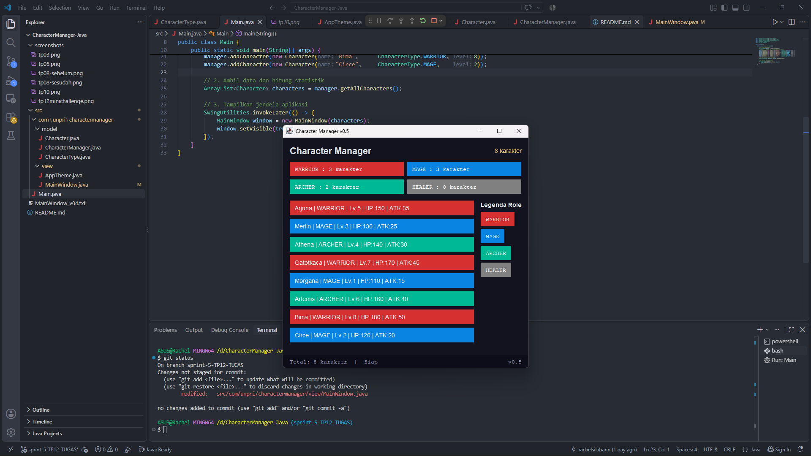
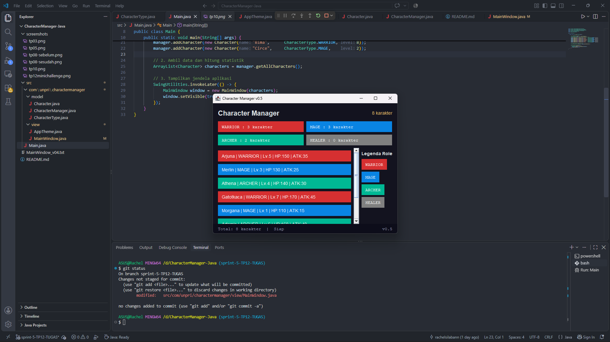
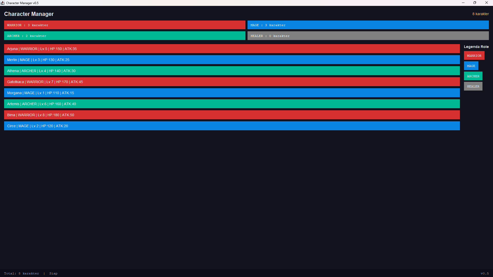

## TP12 — Layout Manager dan Responsive GUI

### 1. Wireframe Aplikasi

Berikut gambaran struktur tampilan aplikasi Character Manager v0.5:

```text
+------------------------------------------------------+
|                    HEADER (NORTH)                    |
|  Character Manager                       8 karakter  |
+------------------------------------------------------+
|                  PANEL STATISTIK                     |
|  WARRIOR: 3       | MAGE: 3                          |
|  ARCHER: 2        | HEALER: 0                        |
+-------------------------------------------+----------+
|                                           |          |
|             DAFTAR KARAKTER               | LEGENDA  |
|                 (CENTER)                  |  (EAST)  |
|                                           |          |
|  Arjuna                                   | WARRIOR  |
|  Merlin                                   | MAGE     |
|  Athena                                   | ARCHER   |
|  Gatotkaca                                | HEALER   |
|  Morgana                                  |          |
|  Artemis                                  |          |
|  Bima                                     |          |
|  Circe                                    |          |
|                                           |          |
+-------------------------------------------+----------+
|                    STATUS (SOUTH)                    |
|  Total: 8 karakter | Siap                       v0.5 |
+------------------------------------------------------+
```

### 2. Screenshot Implementasi

**A. Tampilan Ukuran Awal**



**B. Tampilan Jendela Dikecilkan**



**C. Tampilan Jendela Dilebarkan**



### 3. Pengamatan Perubahan Ukuran Jendela

| Kondisi | Prediksi | Hasil Pengamatan |
|---|---|---|
| Ukuran awal | Semua komponen tampil sesuai susunan layout | Komponen tampil dengan rapi |
| Jendela dilebarkan | Area daftar karakter menyesuaikan ruang yang tersedia | Daftar karakter melebar dan komponen tetap tersusun |
| Jendela dikecilkan | Area daftar karakter menjadi terbatas dan scrollbar digunakan | Scrollbar muncul sehingga daftar karakter tetap dapat diakses |

### 4. Struktur Panel Bersarang

Aplikasi menggunakan `BorderLayout` sebagai layout utama pada `MainWindow`. Bagian NORTH berisi panel pembungkus yang menggunakan `BoxLayout` untuk menyusun header dan panel statistik secara vertikal. Bagian CENTER berisi `JScrollPane` yang menampung panel daftar karakter, sedangkan bagian EAST berisi panel legenda dengan `BoxLayout` Y_AXIS. Bagian SOUTH digunakan sebagai status bar yang menampilkan jumlah karakter di sebelah kiri dan versi aplikasi di sebelah kanan.

### 5. Alasan Pemilihan Layout Panel Tambahan

Panel statistik menggunakan `GridLayout(2, 2)` karena terdapat empat jenis role karakter, yaitu WARRIOR, MAGE, ARCHER, dan HEALER. Dengan GridLayout, setiap informasi statistik memiliki ukuran sel yang sama sehingga tampil lebih teratur dan mudah dibaca.

Layout yang tidak dipilih adalah `FlowLayout`. Meskipun FlowLayout dapat menyusun komponen secara horizontal, susunannya dapat berpindah baris mengikuti lebar ruang yang tersedia. Oleh karena itu, GridLayout lebih sesuai untuk menampilkan empat informasi statistik dalam susunan dua baris dan dua kolom.

### 6. Analisis Layout dan MVC

Dokumen analisis lengkap mengenai Layout Manager dan Model-View-Controller (MVC) dapat dibaca melalui Google Docs berikut:

**Link Dokumen Analisis:**
[Analisis Layout Manager dan MVC — Character Manager v0.5](https://1drv.ms/w/c/8cf06abcf94f4402/IQDfB94ljsVwTLhj_W_wiMKAAWwX6xQFQughzRvGg4z2CQU?e=0dkfxN)

### 7. Identitas Mahasiswa
- Nama: Rachel Clarita Oktaviana Br Silaban
- NIM: 253303621203
- Kelas: Sistem Informasi 3 Pagi A
- Tugas: TP12 — Layout Manager dan Responsive GUI