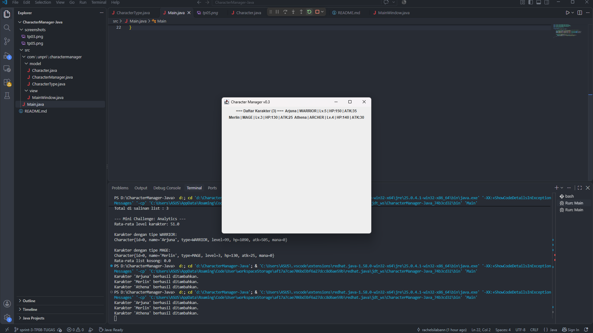
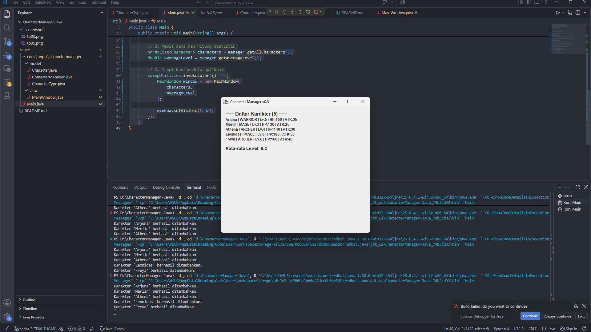

## TP8 — MainWindow, Data Dinamis & Analisis MVC

### 1. Screenshot Output

#### Sebelum Perubahan Data

Menampilkan tiga karakter awal, yaitu Arjuna, Merlin, dan Athena, beserta statistik rata-rata level.



#### Sesudah Perubahan Data

Menampilkan lima karakter setelah penambahan Leonidas dan Freya. Statistik rata-rata level ikut berubah menjadi 5.2.



### 2. Aliran Data dan Penerapan MVC

Pada aplikasi Character Manager, `Main.java` berperan sebagai bagian yang mengatur jalannya program. Pertama, Main membuat objek `CharacterManager` dan menambahkan data karakter ke dalamnya. Selanjutnya, `CharacterManager` sebagai bagian dari Model bertanggung jawab mengelola data karakter, menyediakan daftar karakter melalui method `getAllCharacters()`, serta menghitung rata-rata level menggunakan method `getAverageLevel()`.

Setelah data dan statistik diperoleh, Main mengirimkannya ke `MainWindow` sebagai View. `MainWindow` bertugas menampilkan daftar karakter secara dinamis menggunakan perulangan `for-each` dan menampilkan nilai rata-rata level melalui JLabel. Dengan pemisahan tersebut, pengelolaan data berada di Model, sedangkan tampilan antarmuka berada di View. Selain itu, `SwingUtilities.invokeLater()` digunakan agar pembuatan dan pengoperasian GUI dijalankan melalui Event Dispatch Thread (EDT).

### 3. Karakter Tambahan

Pada TP8, dua karakter baru ditambahkan sehingga jumlah keseluruhan karakter menjadi lima.

| Karakter |  Tipe  | Level |                                  Alasan Pemilihan                                                |
| -------- | ------ | ----- | -------------------------------------------------------------------------------------------------|
| Leonidas | MAGE   |   8   | Memberikan variasi level yang lebih tinggi sehingga dapat menunjukkan perubahan nilai rata-rata. |
| Freya    | ARCHER |   6   | Menambah variasi tipe karakter dan memberikan nilai level yang berbeda dari karakter lainnya.    |

Karakter Arjuna, Merlin, dan Athena tetap dipertahankan sebagai data awal. Penambahan Leonidas dan Freya dilakukan untuk menguji kemampuan aplikasi dalam menampilkan data secara dinamis serta menghitung ulang statistik berdasarkan jumlah dan level karakter yang tersedia.

**Perhitungan rata-rata level:**

(5 + 3 + 4 + 8 + 6) / 5 = 5.2

Dengan demikian, aplikasi menampilkan statistik **Rata-rata Level: 5.2**.

### 4. Struktur Folder Project

```text
CharacterManager-Java/
├── src/
│   ├── Main.java
│   └── com/
│       └── unpri/
│           └── charactermanager/
│               ├── model/
│               │   ├── Character.java
│               │   ├── CharacterManager.java
│               │   └── CharacterType.java
│               └── view/
│                   └── MainWindow.java
├── screenshots/
│   ├── tp03.png
│   ├── tp05.png
│   ├── tp08-sebelum.png
│   └── tp08-sesudah.png
└── README.md
```

### 5. Identitas Mahasiswa

- **Nama Lengkap:** Rachel Clarita Oktaviana Br Silaban
- **NIM:** 253303621203
- **Kelas:** Sistem Informasi 3 Pagi A
- **Dokumen Analisis GUI dan MVC:** [Buka Dokumen Analisis](https://1drv.ms/w/c/8cf06abcf94f4402/IQC-q9Mp5yK9Tqinx680e9znAUFLsQiJQNq4irlAKeo1qj4?e=aAcQvi)
