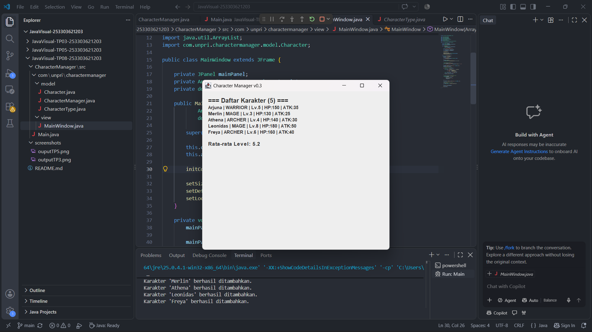
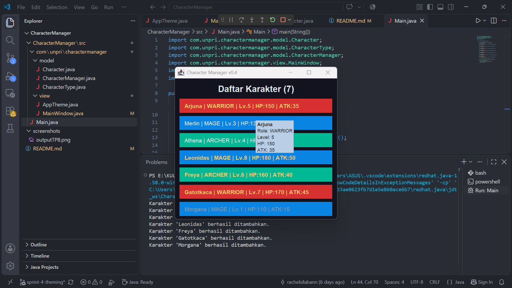

# TP10 — Character Manager Sprint #4
## Theming, Properti Komponen & Analisis MVC

### 1. Mini-Challenge
Pada TP10, aplikasi Character Manager dikembangkan dengan menambahkan fitur penanda karakter berdasarkan level. Karakter yang memiliki level minimal 5 akan menampilkan teks berwarna emas dan menggunakan font tebal (*bold*). Batas level disimpan dalam konstanta `GOLD_LEVEL_THRESHOLD` agar nilai batas dapat diubah dengan mudah tanpa harus mengubah banyak bagian kode.

### 2. Penambahan Karakter
Aplikasi memiliki tujuh karakter dengan variasi role dan level sebagai berikut:
| Nama      | Role    | Level |
| --------- | ------- | ----- |
| Arjuna    | WARRIOR |   5   |
| Gatotkaca | WARRIOR |   7   |
| Merlin    | MAGE    |   3   |
| Leonidas  | MAGE    |   8   |
| Morgana   | MAGE    |   1   |
| Athena    | ARCHER  |   4   |
| Freya     | ARCHER  |   6   |
Penambahan karakter dengan role dan level yang berbeda digunakan untuk menguji tampilan kartu berdasarkan role serta fitur Mini-Challenge.

### 3. Penggunaan AppTheme
Seluruh pengaturan warna, font, dan border disimpan dalam class `AppTheme` yang berada di package `view`. Warna disimpan di `AppTheme` agar pengaturan tampilan aplikasi berada pada satu tempat sehingga lebih mudah dikelola dan diubah. Class `Character` hanya bertanggung jawab menyimpan data dan informasi karakter, seperti nama, role, level, HP, dan attack power. Dengan pemisahan ini, Model tidak bergantung pada komponen tampilan sehingga struktur program menjadi lebih rapi dan sesuai dengan konsep MVC.

### 4. Properti Tambahan
**a. Tooltip Detail Karakter**
Properti `setToolTipText()` digunakan untuk menampilkan informasi nama, role, level, HP, dan attack power ketika kursor diarahkan ke kartu karakter.
Alasan: Fitur ini membantu pengguna mengetahui informasi karakter secara lebih lengkap tanpa memenuhi tampilan utama aplikasi.
**b. Status Nonaktif Karakter Level 1**
Properti `setEnabled(false)` digunakan untuk membuat karakter dengan level 1 tampil dalam kondisi nonaktif.
Alasan: Fitur ini memberikan pembeda visual antara karakter level 1 dengan karakter lainnya dan membantu pengguna mengenali status karakter.

### 5. Screenshot Hasil Aplikasi
**Sebelum — MainWindow v0.3**

**Sesudah — MainWindow v0.4**

### 6. Analisis Properti dan MVC
Analisis mengenai JavaBeans, properti komponen Swing, pengaturan ukuran komponen, penggunaan logical font, serta pemisahan tanggung jawab Model dan View dapat dilihat melalui Google Docs berikut:
**Google Docs:** [https://1drv.ms/w/c/8cf06abcf94f4402/IQBs3m9chqemTJ9iU-kK-c5CAUR8vI5Whxmwp9jxVAjOixU?e=k5OIdn]

### 7. Identitas Mahasiswa
- Nama: Rachel Clarita Oktaviana Br Silaban
- NIM: 253303621203
- Kelas: Sistem Informasi 3 Pagi A
- Tugas: TP10 — Character Manager Sprint #4